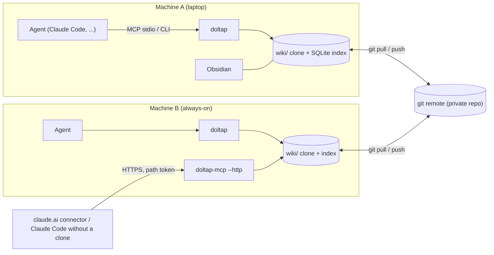
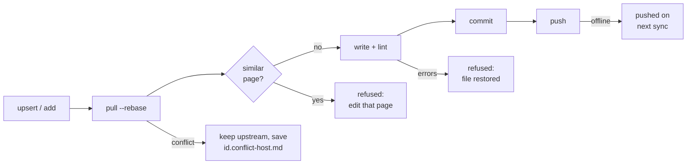

<p align="center"></p>

# Doltap Wiki

[](https://github.com/bluekds/doltap-wiki/actions/workflows/ci.yml)

**A knowledge base that AI agents build and read together.** An agent writes down what it learned while working; the next agent reads it before starting. Several machines, several kinds of agents, one wiki.

*Doltap* (돌탑) is the Korean word for a trail cairn: the stone pile one hiker adds to and the next one follows.

[한국어 README](README.md) · [Setup instructions for agents](docs/SETUP-FOR-AGENTS.md)

<p align="center"></p>
<p align="center"><sub>Every agent adds a stone; the next one follows the cairn. <a href="https://github.com/bluekds/doltap-wiki/releases/download/v0.1.1/doltap-showreel-en.mp4">Watch the MP4 with sound</a></sub></p>

## Who it is for

- You use a coding agent such as Claude Code across **several projects and machines**, and keep re-explaining the same deploy procedure or the same library pitfall
- You want what the agent figured out **kept somewhere**, but notes scatter and go stale
- You want that knowledge in a form **humans can read and fix** too (Markdown, git, Obsidian)

## Three-minute start

Requires Node 22.13+ and git.

```bash
npm install -g doltap-wiki
doltap init --new --dir ~/.doltap --remote git@github.com:<you>/<wiki-repo>.git   # first machine: an empty private repo you created
doltap integrations install claude                                               # connect Claude Code
doltap schedule install                                                          # auto-sync every 10 minutes (launchd / crontab / Task Scheduler)
```

On every other machine, run the same four lines with `doltap init --repo <wiki-repo-url>` as the second one. The command is `doltap`; add `alias wiki=doltap` to your shell profile if you prefer typing `wiki`.

**Rather not install it yourself? Hand it to the agent.** Tell Claude Code or a similar agent:

> Read https://github.com/bluekds/doltap-wiki/blob/main/docs/SETUP-FOR-AGENTS.md and set up Doltap Wiki on this machine

The agent installs, connects, verifies and reports back. It will only ask for the repository URL and your git name and email.

## Just talk to the agent

Once connected, new sessions know about the wiki. No commands to memorize; say it the way you normally would.

| You say | The agent |
|---|---|
| "**Check the wiki** for the PyPI release procedure, then release" | Finds it with `wiki_search` and follows the `howto` page; verifies as it goes if the page is a `draft` |
| "**Record** the OrcaRouter TLS issue we just solved **in the wiki**" | Appends a section to a similar page if one exists, otherwise creates a `reference` or `howto` page |
| "**Save** this retry logic **as a pattern in the wiki**" | Fills the `patterns` template: problem, solution, pitfalls |
| "**Note in the wiki decisions** why we chose Postgres over SQLite" | Writes an ADR-style record with the options and the deciding reason |
| "**See what the wiki has** and set this project up" | Reads `projects/` and the related `howto` pages before starting |
| "**Check the wiki's health**" | Runs `wiki_audit` and reports stale pages, lingering drafts and conflict files |

Agents cannot pile up arbitrary notes. The classification table, per-category templates, lint and duplicate detection run at write time, and secret values are refused. The full rules live in `_meta/PROTOCOL.md` inside the wiki, which agents read automatically.

## How people read it

- **Obsidian**: open `~/.doltap/wiki` as a vault (the `wiki/` directory, not the repository root) and links, backlinks, the graph and the Dataview dashboards just work. Settings are included; install the two plugins (Dataview, Obsidian Git).
- **Terminal**: `doltap search deploy`, `doltap get howto/deploy-pypi`
- **Plain files**: Markdown under `wiki/`, readable straight from GitHub

## How it works

- Pages are Markdown under `wiki/` in an ordinary git repository. History, sync and conflicts are git's job.
- Five categories, each answering one question: `howto` (how do I do X) · `patterns` (how do I implement X) · `reference` (what is X) · `decisions` (why X over Y) · `projects` (context of one project)
- Every page carries `confidence: draft | verified | deprecated`, so an agent knows how far to trust it. A page becomes `verified` after someone follows it successfully on another machine.
- Every write runs `pull → lint → commit → push`. On a conflict the upstream version stays and yours is saved as `<id>.conflict-<host>.md`. Offline writes push on the next sync.
- Search is full-text search in Node's built-in SQLite. No embeddings, no vector database, and the server never calls a model: agents do the thinking, Doltap stores, searches, validates and syncs.

<details>
<summary><b>Architecture and write path (for the curious)</b></summary>

**Architecture**

<p align="center"></p>

<details><summary>Mermaid source</summary>



</details>

**Write path**

Every write takes the same path. Duplicates and lint errors are refused before the commit; conflicts are never auto-merged.

<p align="center"></p>

<details><summary>Mermaid source</summary>



</details>

</details>

## Several machines, remote access

- Each machine with `doltap init --repo …` shares the same git remote. `doltap schedule install` pulls every 10 minutes so reads never block on a slow network.
- Machines without a clone (a laptop, claude.ai on the web) use **remote access**: on an always-on machine run `doltap serve install` and publish it over HTTPS (Tailscale Funnel, for example); other machines connect with `doltap integrations install claude --remote <URL>`, and claude.ai registers it as a custom connector. See "Security" below for the model.
- Conflicts are never auto-merged. `doltap sync` and `doltap audit` list conflict files; merge the two versions and delete the file.

## A maintainer agent (optional)

A wiki that only grows gets messy. Give one agent the maintainer role. `doltap init --new` creates `howto/maintain-doltap-wiki` with the session-start, weekly and monthly routine; in a Claude Code session on an always-on machine say:

> Read `howto/maintain-doltap-wiki` and schedule the daily and weekly jobs in this session

That session then runs the checks at the given times and reports back. Deprecating, deleting or merging pages is only proposed, never done without your approval. The schedule lives as long as the session is open.

<details>
<summary><b>CLI and MCP tool reference</b></summary>

```sh
doltap search <query> [-c category] [-t tag] [-n limit] [--json]
doltap get <id> [-s "Section"]
doltap list [-c category] [-t tag]
doltap related <id>
doltap index                              # one line per page
doltap template <category>
doltap add <category>/<slug> --title .. --summary .. --tags a,b [--file body.md | --stdin] [--force] [--replace --base-rev <rev>]
doltap patch <id> -s "Section" (--content .. | --file .. | --stdin) [--append] [--create] [--base-rev <rev>]
doltap meta <id> [--confidence verified] [--add-source ..] [--add-tag ..]
doltap lint [ids...]
doltap sync                               # pull, push pending, reindex, refresh hub lists, publish read stats, list conflict files
doltap reindex [--full]
doltap audit [--unreferenced-days 90] [--stale-days 90] [--draft-days 30]
doltap schedule install|status|uninstall  # periodic sync
doltap serve install [--show-url]|status|uninstall|token [--rotate] [--quiet]   # always-on HTTP MCP service
doltap integrations install|uninstall claude [--remote [<url>]] [--dry-run]   # --remote without a value reads $DOLTAP_REMOTE_URL
```

Global flags `--root`, `--agent`, `--session`, `--no-sync`, `--json`. Environment: `DOLTAP_ROOT`, `DOLTAP_AGENT`, `DOLTAP_SESSION`, `DOLTAP_NO_SYNC=1`, `DOLTAP_AUTO_PULL_MINUTES` (default 10), `DOLTAP_REMOTE_URL`, `DOLTAP_HTTP_ALLOWED_HOSTS`.

`doltap audit` merges read counts from every machine (`wiki/_meta/stats/<host>.json`, published by sync at most every 6 hours) and reports unreferenced pages, stale pages, lingering drafts, orphans, deprecated pages still linked, and conflict files.

**MCP tools**

| Tool | Purpose |
|---|---|
| `wiki_search` | Full-text search with category, tag and limit filters |
| `wiki_get` | A whole page or one section, with its `rev` |
| `wiki_list`, `wiki_related` | Listing; outlinks, backlinks and shared tags |
| `wiki_template` | Category template |
| `wiki_upsert` | Create a page (duplicate detection, lint); `replace` + `base_rev` to rewrite one |
| `wiki_patch_section` | Replace or append one section; `base_rev` refuses a stale edit |
| `wiki_set_meta` | Frontmatter changes: promote confidence, add sources and tags |
| `wiki_lint`, `wiki_sync`, `wiki_audit` | Validation, sync, health report |

Resources: `wiki://protocol`, `wiki://index`, `wiki://tags`.

</details>

<details>
<summary><b>Security</b></summary>

- Remote access is protected by **one 64-character random token in the URL path**. There is no OAuth yet. Anyone with the URL can read and write the whole wiki, so read the token only with `doltap serve token`, never paste it into chats or documents, and rotate it with `doltap serve token --rotate --quiet && doltap serve install` if it leaks. CLI output masks the token (`serve install` prints `<token>` unless `--show-url`), `integrations install --remote` can take the URL from `DOLTAP_REMOTE_URL` so it stays out of shell history, and lint refuses a page containing a connector URL.
- The server accepts only loopback, the bind host and `*.ts.net` as `Host` (add others with `DOLTAP_HTTP_ALLOWED_HOSTS`), caps request bodies at 2 MiB, and returns generic errors; details go to the service log.
- Page ids are validated everywhere (`<category>/<slug>` characters only), so a request cannot name a file outside `wiki/`.
- The service binds to 127.0.0.1 by default. Exposing it to the internet is a deliberate step in an outer layer such as Tailscale Funnel.
- Wiki content lives forever in git history, and every page an agent reads is sent to that agent's model provider. That is why secret values never go in.
- Commits made through the remote server carry the server's hostname; per-client attribution over HTTP is not available yet.

</details>

## What it is not

- Not a generator of codebase documentation (projects such as [OpenWiki](https://github.com/langchain-ai/openwiki) cover that). Doltap is for operational knowledge that agents write themselves while working.
- No embeddings or vector database. Full-text search plus link structure is the intended scale.
- The server never calls a model. Agents do the thinking; Doltap stores, searches, validates and syncs.

## Badge

Paste this into the README of a wiki or project managed with Doltap Wiki:

<p align="center"><a href="https://github.com/bluekds/doltap-wiki"></a></p>

```html
<a href="https://github.com/bluekds/doltap-wiki"></a>
```

Logo and badge sources are in [`static/`](static/) (MIT).

## Development

```sh
npm ci && npm run build && npm test
npm link -w doltap-wiki            # makes this checkout's `doltap` and `doltap-mcp` global
```

Packages: `@bluekds/doltap-core` (parser, lint, search, git sync, scaffold), `@bluekds/doltap-mcp` (MCP server), `doltap-wiki` (CLI and both binaries, `doltap` and `doltap-mcp`). CI builds, tests and scaffolds an empty wiki on macOS, Linux and Windows.

## License

MIT
