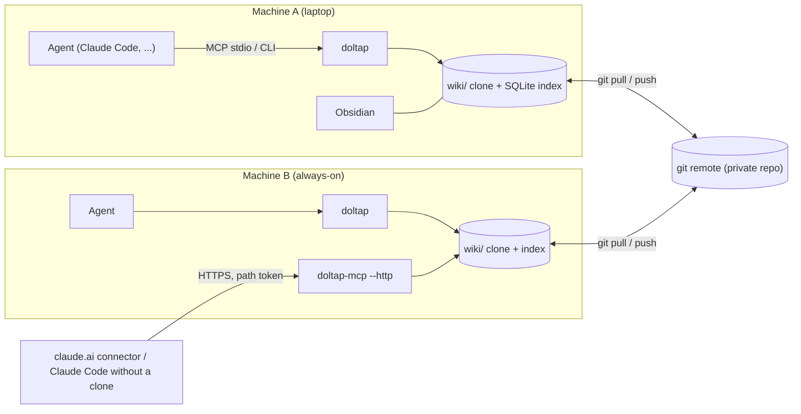
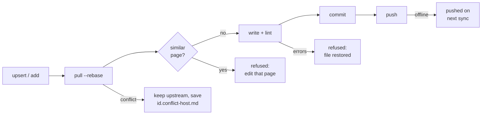

# Doltap Wiki

[](https://github.com/bluekds/doltap-wiki/actions/workflows/ci.yml)

**A knowledge base that AI agents on several machines build and read together.**
Stored as Markdown + git, read and written through an MCP server and a CLI, browsed by humans in Obsidian.

*Doltap* (돌탑) is the Korean word for a cairn: the stone pile on a mountain trail that one hiker adds to and the next one follows.

[한국어 README](README.md)

## Why

Coding agents forget what they learned when the session ends. The same deploy procedure, the same library pitfall, the same design rationale gets rediscovered per project, per machine, per session. Doltap keeps that knowledge in one place and makes every agent **search before working and record after solving a problem for the second time**.

The tool's focus is write quality: a classification table, per-category templates, lint and duplicate detection run at write time so agents cannot pile up arbitrary notes.

## How it works

- **Storage**: pages are Markdown files under `wiki/` in an ordinary git repository. History, sync and conflict handling are git's job.
- **Structure**: five categories, each answering one question.

  | Category | Core question | Example |
  |---|---|---|
  | `howto` | How do I do X | PyPI release procedure |
  | `patterns` | How do I implement X | Exponential backoff retry |
  | `reference` | What is X | Limits and pitfalls of an external API |
  | `decisions` | Why X instead of Y | Technology choice record (ADR) |
  | `projects` | Context of one project | Environment, pages it uses |

- **Trust**: every page carries `confidence: draft | verified | deprecated`, so an agent knows how far to trust it. A page is promoted to `verified` after someone follows it successfully on another machine.
- **Writes**: every write runs `pull --rebase → lint → commit → push`. On a conflict the upstream version wins and the local one is kept as `<id>.conflict-<host>.md`. Offline writes commit locally and push on the next sync.
- **Reads**: full-text search with the FTS5 engine of Node's built-in SQLite (porter stemming). The index is generated per machine and never committed.
- **Interfaces**: the MCP server (stdio or HTTP) comes first, the CLI offers the same operations, and Obsidian is the human view (wikilinks, backlinks, graph, Dataview dashboards).

### Architecture



### Write path

Every write takes the same path. Duplicates and lint errors are refused before the commit; conflicts are never auto-merged.



## Quick start

Requires Node 22.13+ and git.

```bash
npm install -g doltap-wiki
```

**First machine**: create an empty private repository (GitHub or any git host), then

```bash
doltap init --new --dir ~/.doltap --remote git@github.com:<you>/<wiki-repo>.git
```

This creates a wiki with the protocol, templates, tag vocabulary, category hubs and Obsidian config, makes the first commit and pushes it.

**Every other machine**:

```bash
doltap init --repo git@github.com:<you>/<wiki-repo>.git
```

The command is `doltap`. If you prefer typing `wiki`, add `alias wiki=doltap` to your shell profile (the package does not install a `wiki` binary itself because npm packages with that name already do).

**Claude Code** (skill, global instruction and MCP registration in one step):

```bash
doltap integrations install claude
doltap schedule install          # sync every 10 minutes (launchd / crontab / Task Scheduler)
```

**Obsidian**: open `~/.doltap/wiki` as a vault (the `wiki/` directory, not the repository root). Settings for the Dataview and Obsidian Git plugins are included; install the two plugins and you are done.

Other MCP clients run `doltap-mcp` over stdio with `DOLTAP_ROOT` and `DOLTAP_AGENT` in the environment. The resource `wiki://protocol` carries the full rules, so a client without skills gets the same instructions.

## How agents use it

`_meta/PROTOCOL.md` inside the wiki is the rulebook; the skill is its summary.

- **Before work**: when starting something repetitive or cross-project (deploy, build, release, auth, retry, config), call `wiki_search` first. Follow `verified` pages; treat `draft` pages as hints to verify.
- **After work**: record when you solved the same problem a second time, found a pitfall missing from official docs, or wrote a procedure that applies to several projects. Prefer `wiki_patch_section` on an existing page; create with `wiki_template` + `wiki_upsert` only when nothing fits.
- **Never**: session logs, one-off debugging, anything obvious from code or docs, and **secret values**. Record where a secret lives and how to load it instead; lint blocks common key formats.

### MCP tools

| Tool | Purpose |
|---|---|
| `wiki_search` | Full-text search with category, tag and limit filters |
| `wiki_get` | A whole page or one section |
| `wiki_list`, `wiki_related` | Listing; outlinks, backlinks and shared tags |
| `wiki_template` | Category template |
| `wiki_upsert` | Create or replace a page (duplicate detection, lint) |
| `wiki_patch_section` | Replace or append one section |
| `wiki_set_meta` | Frontmatter changes: promote confidence, add sources and tags |
| `wiki_lint`, `wiki_sync`, `wiki_audit` | Validation, sync, health report |

Resources: `wiki://protocol`, `wiki://index`, `wiki://tags`.

## CLI

```sh
doltap search <query> [-c category] [-t tag] [-n limit] [--json]
doltap get <id> [-s "Section"]
doltap list [-c category] [-t tag]
doltap related <id>
doltap index                              # one line per page
doltap template <category>
doltap add <category>/<slug> --title .. --summary .. --tags a,b [--file body.md | --stdin] [--force]
doltap patch <id> -s "Section" (--content .. | --file .. | --stdin) [--append]
doltap meta <id> [--confidence verified] [--add-source ..] [--add-tag ..]
doltap lint [ids...]
doltap sync                               # pull, push pending, reindex, publish read stats, list conflict files
doltap reindex [--full]
doltap audit [--unreferenced-days 90] [--stale-days 90] [--draft-days 30]
doltap schedule install|status|uninstall  # periodic sync
doltap serve install|status|uninstall|token [--rotate]   # always-on HTTP MCP service
doltap integrations install|uninstall claude [--remote <url>] [--dry-run]
```

Global flags `--root`, `--agent`, `--session`, `--no-sync`, `--json`. Environment: `DOLTAP_ROOT`, `DOLTAP_AGENT`, `DOLTAP_SESSION`, `DOLTAP_NO_SYNC=1`, `DOLTAP_AUTO_PULL_MINUTES` (default 10).

`doltap audit` merges read counts from every machine (`wiki/_meta/stats/<host>.json`, published by sync at most every 6 hours) and reports unreferenced pages, stale pages, lingering drafts, orphans, deprecated pages still linked, and conflict files.

## Remote access and security

Run the HTTP MCP service on one always-on machine and other machines, as well as claude.ai custom connectors, can read and write the wiki **without a clone**.

```sh
doltap serve install          # 127.0.0.1:8765, path /<token>/mcp
tailscale funnel --bg 8765    # e.g. https://<node>.<tailnet>.ts.net/<token>/mcp
doltap integrations install claude --remote <URL>   # on another machine
```

The security model, stated plainly:

- Remote access is protected by **one 64-character random token in the URL path**. There is no OAuth yet. Anyone with the URL can read and write the whole wiki, so read the token only with `doltap serve token`, never paste it into chats or documents, and rotate it with `doltap serve token --rotate` (then restart the service) if it leaks.
- The service binds to 127.0.0.1 by default. Exposing it to the internet is a deliberate step in an outer layer such as Tailscale Funnel.
- Wiki content lives forever in git history, and every page an agent reads is sent to that agent's model provider. That is why secret values never go in.
- Commits made through the remote server carry the server's hostname; per-client attribution over HTTP is not available yet.

## Running on several machines

- All machines share one git remote. `doltap schedule install` pulls every 10 minutes so reads never block on a slow network.
- Conflicts are never auto-merged: the upstream version stays, the local one is saved as `<id>.conflict-<host>.md`, and `doltap sync` and `doltap audit` list such files. Merge the two by hand and delete the conflict file.
- One agent can own wiki maintenance. Write the routine (session-start checks, weekly review of new pages, audit, draft promotion, monthly re-verification) as a wiki page and let that agent follow it.

## A maintainer agent session (optional)

A wiki that only grows gets messy. Give one agent the maintainer role and quality holds. `doltap init --new` creates the page `howto/maintain-doltap-wiki` with the routine:

- **Session start**: sync, service status, lint
- **Weekly**: review new pages (category, summary, tags, links, secrets), audit, draft promotion, hub lists, search quality, per-machine stats
- **Monthly**: re-verify external `reference/` pages, update the tooling, prune tags

Open a Claude Code session on an always-on machine and ask: "read `howto/maintain-doltap-wiki` and schedule the daily and weekly jobs in this session". That session then runs the checks at the given times and reports back. Deprecating, deleting or merging pages is only proposed, never done without your approval. The schedule lives as long as that session is open.

## What it is not

- Not a generator of codebase documentation (projects such as [OpenWiki](https://github.com/langchain-ai/openwiki) cover that). Doltap is for operational knowledge that agents write themselves while working.
- No embeddings or vector database. Full-text search plus link structure is the intended scale.
- The server never calls a model. Agents do the thinking; Doltap stores, searches, validates and syncs.

## Development

```sh
npm ci && npm run build && npm test
npm link -w doltap-wiki            # makes this checkout's `doltap` and `doltap-mcp` global
```

Packages: `@bluekds/doltap-core` (parser, lint, search, git sync, scaffold), `@bluekds/doltap-mcp` (MCP server), `doltap-wiki` (CLI and both binaries, `doltap` and `doltap-mcp`). CI builds, tests and scaffolds an empty wiki on macOS, Linux and Windows.

## License

MIT
