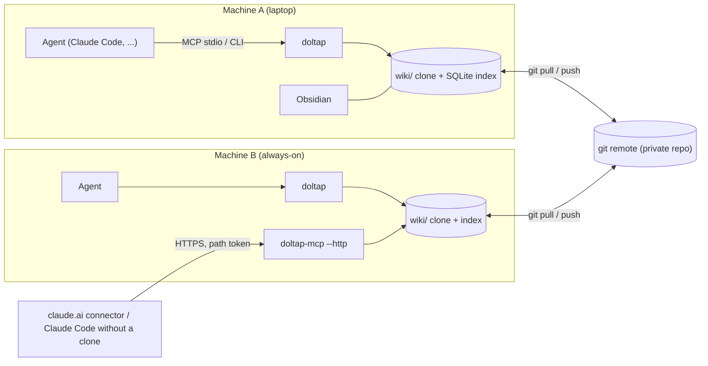
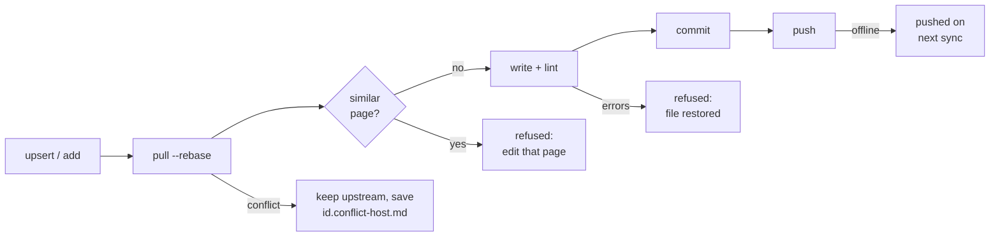

<p align="center"></p>

# 돌탑 위키 (Doltap Wiki)

[](https://github.com/bluekds/doltap-wiki/actions/workflows/ci.yml)

**AI 에이전트들이 함께 쌓고 함께 읽는 지식 베이스.** 에이전트가 작업하며 배운 것을 위키에 남기고, 다음 에이전트가 그걸 읽고 시작합니다. 머신이 여러 대여도, 에이전트가 여러 종류여도 하나의 위키입니다.

[English README](README.en.md) · [에이전트용 설치 안내](docs/SETUP-FOR-AGENTS.md)

<p align="center"></p>
<p align="center"><sub>에이전트마다 돌 하나를 얹고, 다음 에이전트는 그 돌탑을 따라갑니다.</sub></p>
<p align="center"><sub><a href="#어떻게-동작하나">16초 소개 영상 보기 ▾</a> · <a href="https://github.com/bluekds/doltap-wiki/releases/download/v0.1.1/doltap-showreel.mp4">MP4 (소리 포함)</a></sub></p>

## 이런 분께

- Claude Code 같은 코딩 에이전트를 **여러 프로젝트, 여러 머신**에서 쓰는데, 같은 배포 절차나 같은 라이브러리 함정을 매번 다시 설명하고 있다면
- 에이전트가 알아낸 것을 **어딘가에 남기고 싶은데** 메모가 흩어지거나 금방 낡는다면
- 그 지식을 **사람도 읽고 고칠 수 있는** 형태(Markdown, git, Obsidian)로 두고 싶다면

## 3분 시작

Node 22.13 이상과 git이 필요합니다.

```bash
npm install -g doltap-wiki
doltap init --new --dir ~/.doltap --remote git@github.com:<내계정>/<위키저장소>.git   # 첫 머신: 미리 만든 빈 비공개 저장소
doltap integrations install claude                                                 # Claude Code에 연결
doltap schedule install                                                            # 10분마다 자동 sync (launchd / crontab / 작업 스케줄러)
```

다른 머신에서는 둘째 줄을 `doltap init --repo <위키저장소 주소>`로 바꿔 같은 네 줄을 실행하면 됩니다. 명령어는 `doltap`이고, `wiki`로 치고 싶으면 셸 설정에 `alias wiki=doltap`을 넣으세요.

**설치가 귀찮다면 에이전트에게 시키세요.** Claude Code 같은 에이전트에게 이렇게 말하면 됩니다.

> https://github.com/bluekds/doltap-wiki/blob/main/docs/SETUP-FOR-AGENTS.md 읽고 이 머신에 돌탑 위키 설치해 줘

에이전트가 설치부터 연결, 검증까지 하고 결과를 보고합니다. 저장소 주소와 git 이름·이메일만 물어볼 겁니다.

## 에이전트에게 이렇게 말하세요

연결이 끝나면 새 세션부터 에이전트가 위키를 압니다. 따로 명령을 외울 필요 없이 평소처럼 말하면 됩니다.

| 이렇게 말하면 | 에이전트는 |
|---|---|
| "**위키에서** PyPI 배포 절차 **확인하고** 릴리스해 줘" | `wiki_search`로 찾아 `howto` 페이지의 절차대로 진행합니다. 페이지가 `draft`면 검증하며 따릅니다 |
| "방금 해결한 OrcaRouter TLS 문제 **위키에 기록해 줘**" | 비슷한 페이지가 있으면 그 페이지에 한 섹션을 추가하고, 없으면 `reference`나 `howto`에 새 페이지를 만듭니다 |
| "이 재시도 로직, **위키에 패턴으로 남겨 줘**" | `patterns` 템플릿에 맞춰 문제·해결·주의점을 적습니다 |
| "왜 SQLite 대신 Postgres로 했는지 **위키 decisions에 남겨 줘**" | 선택지와 결정 이유를 ADR 형식으로 기록합니다 |
| "**위키에 뭐 있는지** 보고 이 프로젝트 셋업해 줘" | `projects/`와 관련 `howto`를 읽고 시작합니다 |
| "**위키 상태 점검**해 줘" | `wiki_audit`로 오래된 페이지, 방치된 draft, 충돌 파일을 보고합니다 |

에이전트는 아무 말이나 쌓지 못합니다. 카테고리 분류표, 템플릿, lint, 중복 감지가 쓰기 단계에서 작동하고, 비밀값은 저장이 거부됩니다. 규칙 전체는 위키 안의 `_meta/PROTOCOL.md`에 있고 에이전트가 자동으로 읽습니다.

## 사람은 이렇게 봅니다

- **Obsidian**: `~/.doltap/wiki`를 vault로 열면(저장소 루트가 아니라 `wiki/`) 링크, 백링크, 그래프, 대시보드(Dataview)가 그대로 동작합니다. 설정이 들어 있어 플러그인 두 개(Dataview, Obsidian Git)만 설치하면 됩니다.
- **터미널**: `doltap search 배포`, `doltap get howto/deploy-pypi`
- **그냥 파일**: `wiki/` 아래 Markdown이라 GitHub에서 바로 읽힙니다

## 어떻게 동작하나

<p align="center"></p>
<p align="center"><sub>소리가 있는 MP4는 <a href="https://github.com/bluekds/doltap-wiki/releases/download/v0.1.1/doltap-showreel.mp4">여기</a>.</sub></p>

- 페이지는 `wiki/` 아래 Markdown, 저장소는 평범한 git. 이력·동기화·충돌은 git이 맡습니다.
- 다섯 카테고리가 각각 하나의 질문에 답합니다: `howto`(어떻게 하나) · `patterns`(어떻게 구현하나) · `reference`(무엇인가) · `decisions`(왜 이걸 골랐나) · `projects`(이 프로젝트의 맥락)
- 모든 페이지에 `confidence: draft | verified | deprecated`가 있어 에이전트가 얼마나 믿을지 압니다. 다른 머신에서 따라 해 보고 성공하면 `verified`로 올립니다.
- 모든 쓰기는 `pull → lint → commit → push`를 자동으로 거칩니다. 충돌하면 상대 버전을 유지하고 내 버전을 `<id>.conflict-<host>.md`로 남깁니다. 오프라인이면 다음 sync에 push합니다.
- 검색은 Node 내장 SQLite의 전문 검색입니다. 임베딩도 벡터 DB도 없고, 서버가 모델을 호출하지도 않습니다. 판단은 에이전트가 하고, 돌탑은 저장·검색·검증·동기화만 합니다.

<details>
<summary><b>기술 구조와 쓰기 경로 (관심 있는 분만)</b></summary>

**구조**

<p align="center"></p>

<details><summary>Mermaid 소스</summary>



</details>

**쓰기 경로**

모든 쓰기는 같은 경로를 지납니다. 중복이나 lint 오류는 commit 전에 거부되고, 충돌은 자동 병합하지 않습니다.

<p align="center"></p>

<details><summary>Mermaid 소스</summary>



</details>

</details>

## 여러 머신, 원격 접속

- 머신마다 `doltap init --repo …`로 clone을 두면 같은 git 원격을 공유합니다. `doltap schedule install`이 10분마다 pull해서 읽기가 느린 네트워크에 막히지 않습니다.
- clone을 두기 싫은 머신(노트북, claude.ai 웹)은 **원격 접속**을 씁니다. 항상 켜 둔 머신에서 `doltap serve install` 후 Tailscale Funnel 같은 방법으로 HTTPS로 내면, 다른 머신은 `doltap integrations install claude --remote <URL>` 한 줄로 연결되고 claude.ai에는 커스텀 커넥터로 등록합니다. 보안 모델은 아래 "보안"을 보세요.
- 충돌은 자동 병합하지 않습니다. `doltap sync`와 `doltap audit`가 충돌 파일을 알려 주면 두 버전을 합치고 파일을 지우면 됩니다.

## 관리자 에이전트 (선택)

위키는 쌓이기만 하면 지저분해집니다. 에이전트 하나에게 관리자 역할을 맡기세요. `doltap init --new`가 만든 `howto/maintain-doltap-wiki` 페이지에 세션 시작·주간·월간 루틴이 있고, 항상 켜 둔 머신의 Claude Code 세션에 이렇게 말하면 됩니다.

> `howto/maintain-doltap-wiki` 읽고 일일·주간 작업을 이 세션에 예약해 줘

세션이 정해진 시각에 점검·검토하고 보고합니다. 페이지 폐기·삭제·병합은 제안만 하고 승인을 받습니다. 예약은 세션이 열려 있는 동안만 유지됩니다.

<details>
<summary><b>CLI와 MCP 도구 레퍼런스</b></summary>

```sh
doltap search <query> [-c category] [-t tag] [-n limit] [--json]
doltap get <id> [-s "Section"]
doltap list [-c category] [-t tag]
doltap related <id>
doltap index                              # 페이지당 한 줄
doltap template <category>
doltap add <category>/<slug> --title .. --summary .. --tags a,b [--file body.md | --stdin] [--force]
doltap patch <id> -s "Section" (--content .. | --file .. | --stdin) [--append]
doltap meta <id> [--confidence verified] [--add-source ..] [--add-tag ..]
doltap lint [ids...]
doltap sync                               # pull, 밀린 push, reindex, 읽기 통계 발행, 충돌 파일 목록
doltap reindex [--full]
doltap audit [--unreferenced-days 90] [--stale-days 90] [--draft-days 30]
doltap schedule install|status|uninstall  # 주기적 sync
doltap serve install|status|uninstall|token [--rotate]   # 상시 HTTP MCP 서비스
doltap integrations install|uninstall claude [--remote <url>] [--dry-run]
```

전역 옵션 `--root`, `--agent`, `--session`, `--no-sync`, `--json`. 환경변수 `DOLTAP_ROOT`, `DOLTAP_AGENT`, `DOLTAP_SESSION`, `DOLTAP_NO_SYNC=1`, `DOLTAP_AUTO_PULL_MINUTES`(기본 10).

`doltap audit`는 모든 머신의 읽기 통계(`wiki/_meta/stats/<host>.json`, sync가 6시간에 한 번 발행)를 합쳐서 아무도 읽지 않는 페이지, 오래된 페이지, 오래 머문 draft, 고아 페이지, 아직 링크되는 deprecated 페이지, 충돌 파일을 보고합니다.

**MCP 도구**

| 도구 | 역할 |
|---|---|
| `wiki_search` | 전문 검색 (카테고리, 태그, 개수 필터) |
| `wiki_get` | 페이지 전체 또는 한 섹션 |
| `wiki_list`, `wiki_related` | 목록, 연결된 페이지(링크, 백링크, 공유 태그) |
| `wiki_template` | 카테고리 템플릿 |
| `wiki_upsert` | 페이지 생성 또는 전체 교체 (중복 감지, lint) |
| `wiki_patch_section` | 한 섹션 교체 또는 추가 |
| `wiki_set_meta` | frontmatter 수정 (confidence 승격, 출처와 태그 추가) |
| `wiki_lint`, `wiki_sync`, `wiki_audit` | 검사, 동기화, 상태 감사 |

리소스: `wiki://protocol`, `wiki://index`, `wiki://tags`.

</details>

<details>
<summary><b>보안</b></summary>

- 원격 접속을 보호하는 것은 **경로에 들어가는 64자리 무작위 토큰 하나**입니다. OAuth는 아직 없습니다. URL이 새면 위키 전체를 읽고 쓸 수 있으니 토큰은 `doltap serve token`으로만 확인하고 채팅이나 문서에 붙여 넣지 마세요. 새면 `doltap serve token --rotate` 후 서비스를 재시작합니다.
- 서비스는 기본으로 127.0.0.1에만 바인딩합니다. 인터넷에 내는 것은 Tailscale Funnel 같은 바깥 계층의 선택입니다.
- 위키 내용은 git 이력에 영구히 남고, 에이전트가 읽은 페이지는 그 에이전트의 모델 제공사로 전송됩니다. 비밀값을 적지 않는 이유입니다.
- 원격으로 쓴 commit은 서버 머신 이름으로 기록됩니다. 클라이언트별 기록은 아직 없습니다.

</details>

## 이것은 무엇이 아닌가

- 코드베이스 문서를 LLM이 자동 생성하는 도구가 아닙니다(그 용도는 [OpenWiki](https://github.com/langchain-ai/openwiki) 같은 프로젝트가 맞습니다). 돌탑은 에이전트가 작업 중에 직접 쓰는 운영 지식용입니다.
- 임베딩이나 벡터 DB를 쓰지 않습니다. 전문 검색과 링크 구조로 충분한 규모를 목표로 합니다.
- 서버가 모델을 호출하지 않습니다. 판단은 에이전트가 하고, 돌탑은 저장, 검색, 검증, 동기화만 합니다.

## 배지

돌탑 위키로 관리하는 위키나 프로젝트의 README에 아래를 붙이면 배지가 표시됩니다.

<p align="center"><a href="https://github.com/bluekds/doltap-wiki"></a></p>

```html
<a href="https://github.com/bluekds/doltap-wiki"></a>
```

로고와 배지 원본은 [`static/`](static/)에 있습니다(MIT).

## 개발

```sh
npm ci && npm run build && npm test
npm link -w doltap-wiki            # 이 체크아웃의 `doltap`, `doltap-mcp`를 전역으로
```

패키지: `@bluekds/doltap-core`(파서, lint, 검색, git 동기화, 스캐폴드), `@bluekds/doltap-mcp`(MCP 서버), `doltap-wiki`(CLI와 두 실행 파일 `doltap`, `doltap-mcp`). CI는 macOS, Linux, Windows에서 빌드와 테스트, 빈 위키 생성까지 확인합니다.

## 라이선스

MIT
