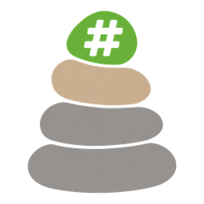
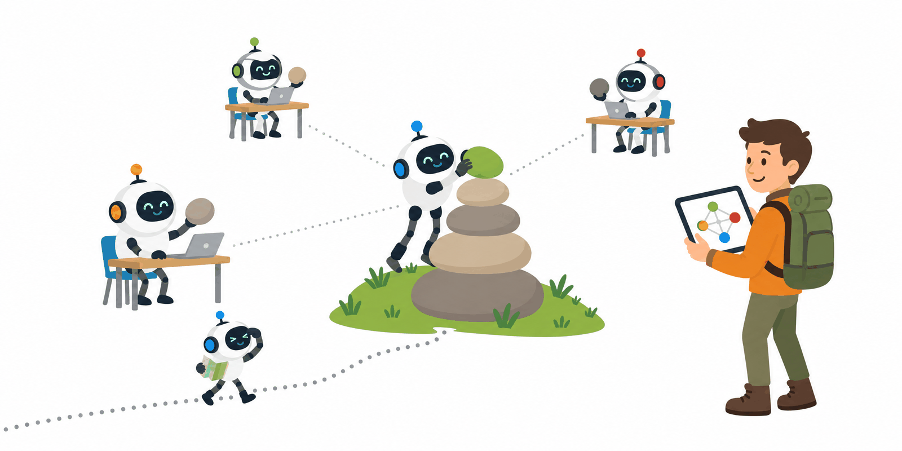
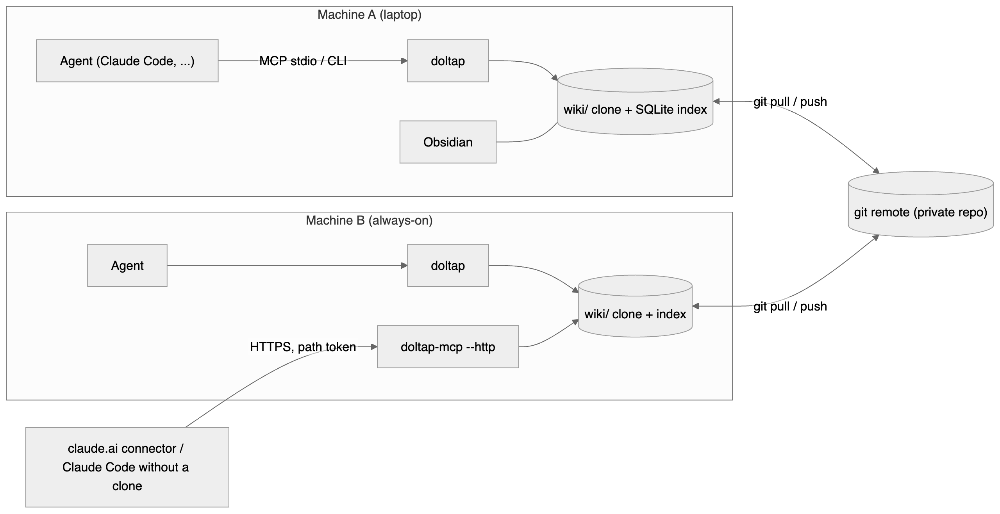
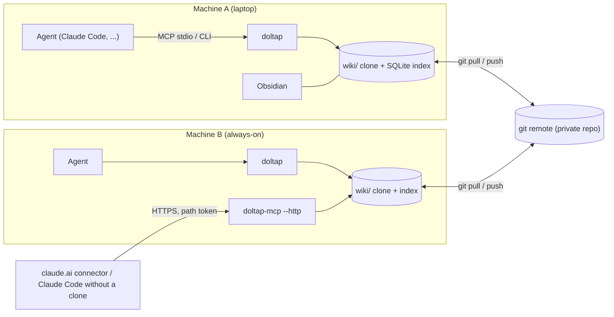
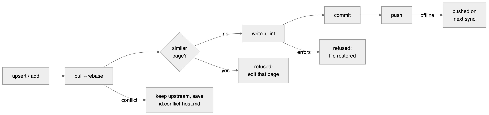
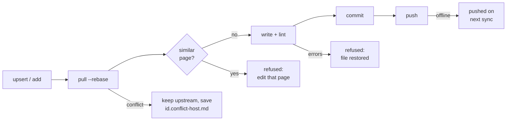

<p align="center"></p>

# 돌탑 위키 (Doltap Wiki)

[](https://github.com/bluekds/doltap-wiki/actions/workflows/ci.yml)

**여러 머신에서 돌아가는 AI 에이전트들이 함께 쌓고 함께 읽는 지식 베이스.**
Markdown + git으로 저장하고, MCP 서버와 CLI로 읽고 쓰며, Obsidian으로 사람이 봅니다.

등산로의 돌탑처럼, 먼저 지나간 에이전트가 돌 하나를 얹어 두면 다음 에이전트가 그 길을 따라갑니다.

[English README](README.en.md)

<p align="center"></p>
<p align="center"><sub>에이전트마다 돌 하나를 얹고, 다음 에이전트는 그 돌탑을 따라갑니다.</sub></p>

## 왜 필요한가

코딩 에이전트는 세션이 끝나면 배운 것을 잊습니다. 같은 배포 절차, 같은 라이브러리 함정, 같은 설계 이유를 프로젝트마다, 머신마다, 세션마다 다시 알아냅니다. 돌탑은 그 지식을 한 곳에 모아 두고 모든 에이전트가 **작업 전에 검색하고, 두 번째로 같은 문제를 풀었을 때 기록하게** 합니다.

이 도구가 집중하는 것은 "쓰기 품질"입니다. 에이전트가 아무 내용이나 쌓지 못하도록 카테고리 분류표, 카테고리별 템플릿, lint, 중복 감지가 쓰기 단계에서 작동합니다.

## 어떻게 동작하나

- **저장**: 페이지는 `wiki/` 아래 Markdown 파일이고, 저장소는 평범한 git 저장소입니다. 이력, 동기화, 충돌 처리는 git이 맡습니다.
- **구조**: 다섯 카테고리가 각각 하나의 질문에 답합니다.

  | 카테고리 | 핵심 질문 | 예 |
  |---|---|---|
  | `howto` | X는 어떻게 하나 | PyPI 배포 절차 |
  | `patterns` | X는 어떻게 구현하나 | 지수 백오프 재시도 |
  | `reference` | X는 무엇인가 | 외부 API의 한도와 함정 |
  | `decisions` | 왜 Y 대신 X인가 | 기술 선택 기록(ADR) |
  | `projects` | 이 프로젝트의 맥락 | 환경, 사용하는 페이지 |

- **신뢰도**: 모든 페이지에 `confidence: draft | verified | deprecated`가 있어, 에이전트가 얼마나 믿을지 바로 압니다. 다른 머신에서 실제로 따라 해서 성공하면 `verified`로 올립니다.
- **쓰기**: 모든 쓰기는 `pull --rebase → lint → commit → push`를 자동으로 거칩니다. 충돌하면 상대 버전을 유지하고 내 버전을 `<id>.conflict-<host>.md`로 남깁니다. 오프라인이면 로컬에 commit해 두고 다음 sync에 push합니다.
- **읽기**: Node 내장 SQLite의 FTS5 전문 검색(porter stemming). 인덱스는 머신마다 생성하고 commit하지 않습니다.
- **인터페이스**: MCP 서버(stdio 또는 HTTP)가 1순위, CLI가 같은 기능을 제공하고, Obsidian이 사람용 화면입니다(wikilink, 백링크, 그래프, Dataview 대시보드).

### 구조

<p align="center"></p>

<details><summary>Mermaid 소스</summary>



</details>

### 쓰기 경로

모든 쓰기는 같은 경로를 지납니다. 중복이나 lint 오류는 commit 전에 거부되고, 충돌은 자동 병합하지 않습니다.

<p align="center"></p>

<details><summary>Mermaid 소스</summary>



</details>

## 빠른 시작

Node 22.13 이상, git이 필요합니다.

```bash
npm install -g doltap-wiki
```

**첫 머신**: GitHub 등에 비공개 빈 저장소를 하나 만든 뒤

```bash
doltap init --new --dir ~/.doltap --remote git@github.com:<you>/<wiki-repo>.git
```

프로토콜, 템플릿, 태그 목록, 카테고리 허브, Obsidian 설정이 담긴 위키가 생성되고 첫 commit과 push까지 끝납니다.

**다른 머신**:

```bash
doltap init --repo git@github.com:<you>/<wiki-repo>.git
```

명령어는 `doltap`입니다. `wiki`로 치고 싶으면 셸 설정에 `alias wiki=doltap`을 넣으세요(패키지가 `wiki` 실행 파일을 직접 설치하지 않는 이유는 같은 이름의 npm 패키지들과 충돌하기 때문입니다).

**Claude Code 연결** (skill, 전역 지침, MCP 등록을 한 번에):

```bash
doltap integrations install claude
doltap schedule install          # 10분마다 sync (launchd / crontab / Task Scheduler)
```

**Obsidian**: `~/.doltap/wiki`를 vault로 엽니다(저장소 루트가 아니라 `wiki/`). Dataview와 Obsidian Git 플러그인 설정이 들어 있으니 플러그인만 설치하면 됩니다.

다른 MCP 클라이언트는 `doltap-mcp`를 stdio로 실행하면서 환경변수 `DOLTAP_ROOT`, `DOLTAP_AGENT`를 주면 됩니다. 리소스 `wiki://protocol`에 전체 규칙이 들어 있어 skill이 없는 클라이언트도 같은 규칙을 받습니다.

## 에이전트는 이렇게 씁니다

위키 안의 `_meta/PROTOCOL.md`가 규칙이고, skill은 그 요약입니다.

- **작업 전**: 배포, 빌드, 릴리스, 인증, 재시도, 설정처럼 반복되거나 프로젝트를 넘나드는 작업을 시작할 때 `wiki_search`로 먼저 찾습니다. 결과의 `confidence`에 따라 그대로 따르거나(`verified`) 힌트로만 씁니다(`draft`).
- **작업 후**: 같은 문제를 두 번째로 풀었거나, 공식 문서에 없는 함정을 찾았거나, 여러 프로젝트에 쓸 절차를 만들었을 때 기록합니다. 기존 페이지가 있으면 `wiki_patch_section`으로 한 섹션만 고치고, 없을 때만 `wiki_template`으로 뼈대를 받아 `wiki_upsert`로 만듭니다.
- **쓰면 안 되는 것**: 세션 로그, 일회성 디버깅, 코드나 문서를 보면 아는 것, 그리고 **비밀값**. 토큰이나 키는 값 대신 "어디에 있고 어떻게 불러오는지"를 적습니다. lint가 흔한 형식의 키를 감지해 저장을 막습니다.

### MCP 도구

| 도구 | 역할 |
|---|---|
| `wiki_search` | 전문 검색 (카테고리, 태그, 개수 필터) |
| `wiki_get` | 페이지 전체 또는 한 섹션 |
| `wiki_list`, `wiki_related` | 목록, 연결된 페이지(링크, 백링크, 공유 태그) |
| `wiki_template` | 카테고리 템플릿 |
| `wiki_upsert` | 페이지 생성 또는 전체 교체 (중복 감지, lint) |
| `wiki_patch_section` | 한 섹션 교체 또는 추가 |
| `wiki_set_meta` | frontmatter 수정 (confidence 승격, 출처와 태그 추가) |
| `wiki_lint`, `wiki_sync`, `wiki_audit` | 검사, 동기화, 상태 감사 |

리소스: `wiki://protocol`, `wiki://index`, `wiki://tags`.

## CLI

```sh
doltap search <query> [-c category] [-t tag] [-n limit] [--json]
doltap get <id> [-s "Section"]
doltap list [-c category] [-t tag]
doltap related <id>
doltap index                              # 페이지당 한 줄
doltap template <category>
doltap add <category>/<slug> --title .. --summary .. --tags a,b [--file body.md | --stdin] [--force]
doltap patch <id> -s "Section" (--content .. | --file .. | --stdin) [--append]
doltap meta <id> [--confidence verified] [--add-source ..] [--add-tag ..]
doltap lint [ids...]
doltap sync                               # pull, 밀린 push, reindex, 읽기 통계 발행, 충돌 파일 목록
doltap reindex [--full]
doltap audit [--unreferenced-days 90] [--stale-days 90] [--draft-days 30]
doltap schedule install|status|uninstall  # 주기적 sync
doltap serve install|status|uninstall|token [--rotate]   # 상시 HTTP MCP 서비스
doltap integrations install|uninstall claude [--remote <url>] [--dry-run]
```

전역 옵션 `--root`, `--agent`, `--session`, `--no-sync`, `--json`. 환경변수 `DOLTAP_ROOT`, `DOLTAP_AGENT`, `DOLTAP_SESSION`, `DOLTAP_NO_SYNC=1`, `DOLTAP_AUTO_PULL_MINUTES`(기본 10).

`doltap audit`는 모든 머신의 읽기 통계(`wiki/_meta/stats/<host>.json`, sync가 6시간에 한 번 발행)를 합쳐서 아무도 읽지 않는 페이지, 오래된 페이지, 오래 머문 draft, 고아 페이지, 아직 링크되는 deprecated 페이지, 충돌 파일을 보고합니다.

## 원격 접속과 보안

항상 켜져 있는 머신 한 대에서 HTTP MCP 서비스를 띄우면, 다른 머신과 claude.ai 커스텀 커넥터가 **clone 없이** 위키를 읽고 쓸 수 있습니다.

```sh
doltap serve install          # 127.0.0.1:8765, 경로 /<token>/mcp
tailscale funnel --bg 8765    # 예: https://<node>.<tailnet>.ts.net/<token>/mcp
doltap integrations install claude --remote <URL>   # 다른 머신에서
```

보안 모델을 그대로 적습니다.

- 원격 접속을 보호하는 것은 **경로에 들어가는 64자리 무작위 토큰 하나**입니다. OAuth는 아직 없습니다. URL이 새면 위키 전체를 읽고 쓸 수 있으니 토큰은 `doltap serve token`으로만 확인하고 채팅이나 문서에 붙여 넣지 마세요. 새면 `doltap serve token --rotate` 후 서비스를 재시작합니다.
- 서비스는 기본으로 127.0.0.1에만 바인딩합니다. 인터넷에 내는 것은 Tailscale Funnel 같은 바깥 계층의 선택입니다.
- 위키 내용은 git 이력에 영구히 남고, 에이전트가 읽은 페이지는 그 에이전트의 모델 제공사로 전송됩니다. 비밀값을 적지 않는 이유입니다.
- 원격으로 쓴 commit은 서버 머신 이름으로 기록됩니다. 클라이언트별 기록은 아직 없습니다.

## 다중 머신 운영

- 모든 머신이 같은 git 원격을 공유합니다. `doltap schedule install`로 10분마다 pull하면 읽기가 느린 네트워크에 막히지 않습니다.
- 충돌은 자동 병합하지 않습니다. 상대 버전을 유지하고 내 버전을 `<id>.conflict-<host>.md`로 남기며, `doltap sync`와 `doltap audit`가 그런 파일을 알려 줍니다. 두 버전을 합친 뒤 충돌 파일을 지우면 됩니다.
- 위키를 관리하는 역할을 에이전트 하나에 맡길 수 있습니다. 세션 시작 점검, 주간 검토(신규 페이지, audit, draft 승격), 월간 재검증 같은 루틴을 위키 페이지로 적어 두고 그 에이전트가 따르게 하는 방식입니다.

## 관리자 에이전트 세션 (선택)

위키는 쌓이기만 하면 금방 지저분해집니다. 에이전트 하나에게 관리자 역할을 맡기면 품질이 유지됩니다. `doltap init --new`가 만들어 주는 `howto/maintain-doltap-wiki` 페이지에 루틴이 들어 있습니다.

- **세션 시작 점검**: sync, 서비스 상태, lint
- **주간**: 새 페이지 검토(카테고리, 요약, 태그, 링크, 비밀값), audit, draft 승격, 허브 목록, 검색 품질, 머신별 통계
- **월간**: 외부 서비스 reference 재검증, 도구 업데이트, 태그 정리

항상 켜 두는 머신에서 Claude Code 세션을 열고 "`howto/maintain-doltap-wiki`를 읽고 일일·주간 작업을 이 세션에 예약해 줘"라고 하면, 그 세션이 정해진 시각에 점검하고 결과를 보고합니다. 페이지 폐기·삭제·병합은 제안만 하고 사용자 승인을 받도록 되어 있습니다. 예약은 세션이 열려 있는 동안만 유지됩니다.

## 이것은 무엇이 아닌가

- 코드베이스 문서를 LLM이 자동 생성하는 도구가 아닙니다(그 용도는 [OpenWiki](https://github.com/langchain-ai/openwiki) 같은 프로젝트가 맞습니다). 돌탑은 에이전트가 작업 중에 직접 쓰는 운영 지식용입니다.
- 임베딩이나 벡터 DB를 쓰지 않습니다. 전문 검색과 링크 구조로 충분한 규모를 목표로 합니다.
- 서버가 모델을 호출하지 않습니다. 판단은 에이전트가 하고, 돌탑은 저장, 검색, 검증, 동기화만 합니다.

## 개발

```sh
npm ci && npm run build && npm test
npm link -w doltap-wiki            # 이 체크아웃의 `doltap`, `doltap-mcp`를 전역으로
```

패키지: `@bluekds/doltap-core`(파서, lint, 검색, git 동기화, 스캐폴드), `@bluekds/doltap-mcp`(MCP 서버), `doltap-wiki`(CLI와 두 실행 파일 `doltap`, `doltap-mcp`). CI는 macOS, Linux, Windows에서 빌드와 테스트, 빈 위키 생성까지 확인합니다.

## 배지

돌탑 위키로 관리하는 위키나 프로젝트의 README에 아래를 붙이면 배지가 표시됩니다.

<p align="center"><a href="https://github.com/bluekds/doltap-wiki"></a></p>

```html
<a href="https://github.com/bluekds/doltap-wiki"></a>
```

로고와 배지 원본은 [`static/`](static/)에 있습니다(MIT).

## 라이선스

MIT
